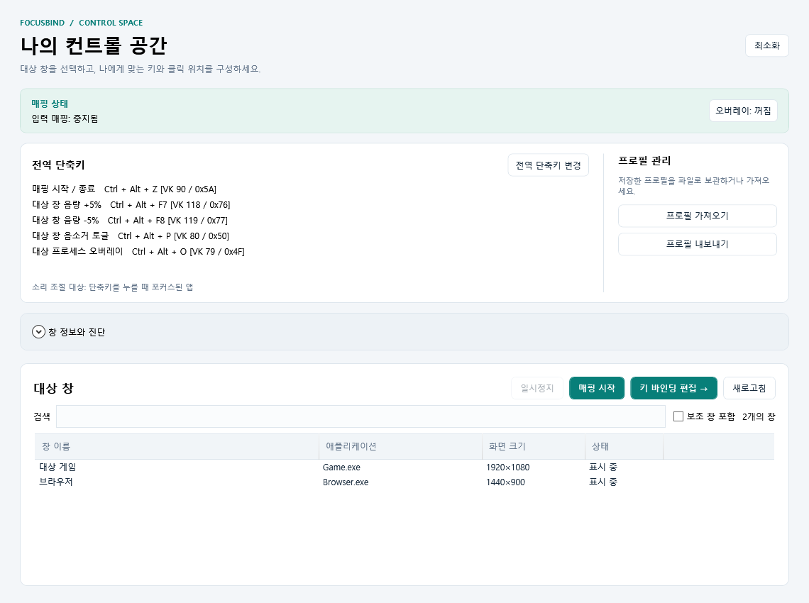
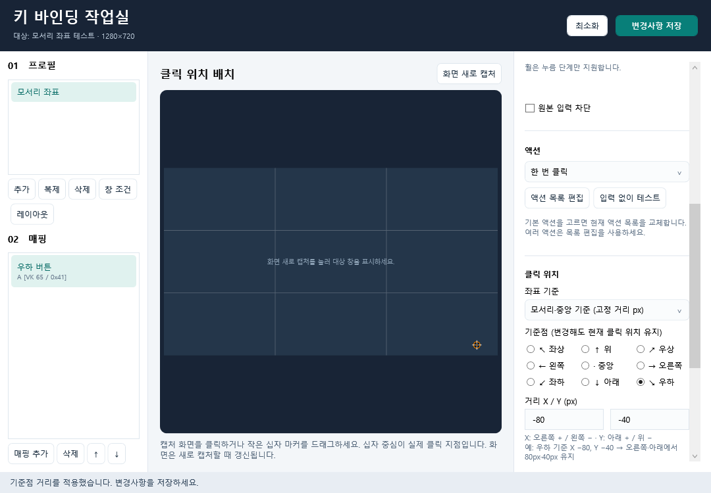

# FocusBind


**자주 쓰는 키를 앱별 클릭·스크롤·반복 동작으로 연결하는 Windows 도구입니다.**

대상 창에 포커스를 두었을 때만 매핑을 실행하고, 창 크기에 맞는 좌표와 단축키 오버레이를 설정할 수 있습니다.

**Windows x64 · v0.1.0-preview.3** · [릴리스 노트](docs/releases/v0.1.0-preview.3.md) · [검증 안내](TESTING.md)

다운로드는 이 저장소의 **Releases**에서 해당 버전의 Windows x64 ZIP을 선택하세요.

> Windows 10/11 x64 · .NET 런타임 포함 · 설치 없이 압축 해제 후 실행 · 관리자 권한 필요

## 주요 기능

| 기능 | 할 수 있는 일 |
| --- | --- |
| 창별 프로파일 | 실행 파일 경로/이름, 창 클래스, 제목 조건에 맞는 매핑 적용 |
| 조합키 입력 | 키보드·마우스 버튼·수직/수평 휠에 Ctrl·Alt·Shift·Win 조합 지정 |
| 클릭·반복·스크롤 | 한 번 클릭, 횟수·간격을 정한 반복, 네 방향 휠, 키·대기 액션 구성 |
| 모서리 기준 좌표 | 창 비율 또는 3×3 기준점의 고정/비례 거리로 클릭 위치 지정 |
| 전역 단축키 | 매핑 시작/종료, 앱 음량·음소거, 프로세스 오버레이 토글 |
| 단축키 오버레이 | 선택한 프로세스 위에 매핑 표시, 투명도 조절, 클릭 통과 |
| 프로파일 공유 | JSON 내보내기/가져오기, 충돌 시 병합·복사본 추가·건너뛰기 선택 |
| 입력 없는 테스트 | 실제 클릭 없이 계산 좌표와 실행 순서 확인 |
| 선택형 진단 로그 | 기본 꺼짐, 필요할 때 배포본에서도 켜기/끄기 |

<details>
<summary>설정 화면 예시 보기</summary>

아래 이미지는 예제 데이터로 자동 렌더링한 화면입니다.

**메인 화면**



**모서리 기준 좌표 설정**



</details>

## 빠른 시작

1. 저장소의 **Releases**에서 `FocusBind-0.1.0-preview.3-win-x64.zip`을 내려받아 **전체 압축 해제**합니다. 파일들을 같은 폴더에 두세요.
2. `FocusBind.App.exe`를 실행하고 Windows 관리자 권한 요청을 승인합니다.
3. 메인에서 대상 창을 검색·선택하고 **키 바인딩 편집**을 엽니다.
4. **매핑 추가** 후 입력 키를 지정하고, 마커를 드래그하거나 **화면에서 지점 선택**으로 클릭 위치를 정합니다.
5. **변경사항 저장**을 누르고 편집기를 닫습니다.
6. **매핑 시작**을 누른 뒤 대상 창으로 돌아가 설정한 키를 사용합니다.

대상 창에 포커스가 있을 때 매핑을 실행합니다. 편집기를 열면 매핑을 중지하므로 저장 후 다시 시작하세요. 메인 창을 최소화해도 매핑과 전역 단축키는 유지됩니다.

## 기본 전역 단축키

| 기능 | 기본값 |
| --- | --- |
| 매핑 시작 / 종료 | **Ctrl + Alt + Z** |
| 포커스된 앱 음량 +5% | Ctrl + Alt + F7 |
| 포커스된 앱 음량 -5% | Ctrl + Alt + F8 |
| 포커스된 앱 음소거 토글 | Ctrl + Alt + P |
| 대상 프로세스 오버레이 토글 | Ctrl + Alt + O |

**전역 단축키 변경**에서 보조키를 체크하고 키 목록에서 원하는 키를 선택한 뒤 **저장 및 적용**을 누르세요. 기록란에서 직접 조합을 눌러도 됩니다. 다른 앱과 등록이 충돌하거나 같은 조합을 중복 지정하면 오류를 표시합니다.

업데이트 시 기존 단축키를 유지합니다. 위 기본값으로 바꾸려면 **기본값 복원 → 저장 및 적용**을 누르세요. 모든 전역 기능의 기본값이 함께 복원됩니다. 소리 조절은 단축키를 누르는 순간 포커스된 창의 프로세스에 적용됩니다.

## 매핑 설정

### 입력과 실행 동작

오른쪽 설정에서 트리거 종류와 **입력 보조키**를 지정하세요. **다음 입력 기록**으로 키·마우스 버튼·휠을 기록할 수도 있습니다.

- **누름 / 뗌 / 길게 누름**을 선택할 수 있습니다. 길게 누름 시간은 50~60000ms이며, 휠은 누름만 지원합니다.
- **원본 입력 차단**을 켜면 매핑된 입력이 대상 앱에 전달되는 것을 차단합니다. 차단에는 저수준 입력 훅이 필요하며 앱 환경에 따라 전달 방식이 다를 수 있습니다.
- 기본 액션은 한 번 클릭·반복 클릭·마우스 휠입니다. 여러 동작을 연결하려면 **액션 목록 편집**에서 키·클릭·휠·대기·반복을 구성하세요.
- 기본 액션으로 전환하면 현재 액션 목록을 교체합니다. 목록의 **↑/↓**로 매핑 순서를 바꾸고 **이 매핑 사용**으로 개별 활성화합니다.

### 창 크기가 바뀌는 경우: 모서리 기준 좌표

버튼이 오른쪽 아래처럼 창 가장자리에 붙어 있다면 다음과 같이 설정하세요.

1. 매핑을 선택하고 오른쪽 **클릭 위치 → 좌표 기준**을 엽니다.
2. **모서리·중앙 기준 (고정 거리 px)**를 선택합니다. 현재 위치에서 가까운 기준점이 자동 선택됩니다.
3. 3×3 버튼에서 기준점을 고르고, 마커를 이동하거나 X/Y 거리를 입력합니다.
4. **변경사항 저장** 후 매핑을 다시 시작합니다.

**예: 우하 기준 / X -80 / Y -40** → 오른쪽 가장자리에서 왼쪽으로 80px, 아래 가장자리에서 위로 40px 떨어진 지점을 유지합니다. X는 오른쪽이 양수, Y는 아래가 양수입니다. 기준점을 바꿔도 현재 클릭 위치를 유지합니다.

| 좌표 기준 | 적합한 경우 |
| --- | --- |
| 콘텐츠 비율 | 화면 전체에 비례해 배치되는 버튼 |
| 모서리·중앙 기준 (고정 거리 px) | 창 크기가 달라도 가장자리에서 거리가 일정한 버튼 |
| 모서리·중앙 기준 (크기에 비례) | 기준점과의 거리도 게임 UI 크기에 따라 확대·축소되는 버튼 |
| 창 전체 비율 | 콘텐츠 여백을 포함한 창 클라이언트 전체 기준 |
| 창 왼쪽 위 기준 고정 픽셀 | 왼쪽 위에서 픽셀 위치가 일정한 버튼 |

고정 거리는 **물리 픽셀**이며 콘텐츠 영역의 모서리를 기준으로 합니다. 기본 콘텐츠 영역은 창 전체입니다. DPI나 게임 UI 배율 자체가 달라지면 위치를 확인하세요. 기존 프로파일은 자동 변환하지 않습니다.

왼쪽 **레이아웃**에서 콘텐츠 여백, 기준 크기, 종횡비 범위, 우선순위와 비례 거리의 배율 정책을 설정할 수 있습니다. 기본 또는 좌표 액션에서 참조 중인 레이아웃은 삭제할 수 없습니다. 실행 시 선택되는 레이아웃과 액션이 참조하는 레이아웃이 일치해야 합니다.

### Ctrl + 휠과 확대·축소

**Ctrl+휠을 입력으로 사용**하려면 트리거를 **휠 위/아래**로 선택하고 **입력 보조키 → Ctrl**을 체크하세요.

**키를 눌렀을 때 Ctrl+휠 출력**을 보내려면 트리거 키를 지정하고 **액션 → 마우스 휠 → 출력 보조키 → Ctrl**을 체크하세요. Alt·Shift·Win도 함께 사용할 수 있으며 입력·출력 보조키는 독립적입니다.

출력은 위·아래·오른쪽·왼쪽을 지원합니다. 양은 1~12000이며 한 칸은 120, 세 칸은 360입니다. **휠은 현재 커서 위치에 출력**하므로 대상 창 위에 커서를 두세요. 확대·축소 여부와 방향은 대상 앱의 휠 동작에 따릅니다.

### 클릭 방식

| 방식 | 동작과 사용 기준 |
| --- | --- |
| 커서 이동 | 커서 도착을 확인하고 클릭합니다. 게임에서는 이 방식부터 확인하세요. |
| 빠른 이동·클릭·복원 | 커서를 이동해 즉시 누르고 뗀 뒤 약 20ms 후 복원합니다. 클릭 누락 시 기본 방식을 비교하세요. |
| 창 메시지 | 커서를 옮기지 않고 창 메시지를 보냅니다. 일부 앱만 지원하며 Unity 창에서는 차단합니다. |

**클릭 후 커서 원위치**를 끄면 클릭 지점에 커서를 둡니다. 포커스 상실·좌표 변경·커서 이동 실패 시 실행을 중단하고, 사용자가 커서를 움직이면 복원을 생략합니다.

### 저장 전 확인

**입력 없이 테스트**로 초안의 대상 크기·DPI, 계산 좌표, 출력 순서를 확인할 수 있습니다. 실제 입력을 보내거나 대상 창을 활성화하지 않습니다. 게임이 클릭·휠을 받아들이는지는 대상 앱에서 따로 확인하세요.

각 상세 설정창의 **적용**은 편집기 초안에 반영합니다. 파일에 저장하려면 편집기 상단 **변경사항 저장**을 누르고, 편집기를 닫은 뒤 매핑을 다시 시작하세요.

## 단축키 오버레이

1. 메인의 **오버레이: 꺼짐** 버튼으로 설정을 엽니다.
2. 대상 프로세스를 선택하고 **대상 프로세스에 단축키 오버레이 표시**를 켭니다.
3. 투명도를 지정하고 **저장 및 적용**을 누릅니다.

투명도는 0%(불투명)~100%(완전 투명), 기본 35%입니다. 선택한 프로세스의 창이 포커스되면 좌표 매핑은 클릭 지점에, 좌표가 없는 매핑은 왼쪽 위에 표시합니다. 전역 음량 단축키는 표시하지 않습니다.

오버레이는 매핑 실행과 독립적이며 클릭을 통과시키도록 구성했습니다. 대상 외 포커스·최소화·편집 중에는 숨기고, 매핑 중지 상태에서는 참고용으로 유지합니다. 실행 파일 기준으로 대상을 저장하므로 프로세스를 다시 실행해도 적용됩니다.

## 프로파일 공유와 병합

메인의 **프로필 내보내기**로 저장된 전체 프로파일을 JSON으로 저장하고, 다른 컴퓨터에서 **프로필 가져오기**로 불러올 수 있습니다. 편집기는 닫아두세요.

같은 ID 또는 이름(대소문자·앞뒤 공백 제외)의 프로파일이 있으면 각각 선택합니다.

| 선택 | 결과 |
| --- | --- |
| 병합 | 기존 설정과 같은 ID·단축키의 매핑을 유지하고, 새 매핑과 필요한 레이아웃 추가 |
| 복사본 추가 (기본) | 새 ID와 중복되지 않는 이름으로 별도 프로파일 추가 |
| 건너뛰기 | 해당 프로파일 제외 |

충돌 대상이 여러 개면 병합할 기존 프로파일을 고를 수 있습니다. 기존 창 선택은 유지하며, 적용 전 현재 파일을 `profiles.json.backup-*.json`으로 백업합니다. 전체 취소·모두 건너뛰기는 설정을 바꾸지 않습니다. 현재 파일이 손상됐으면 확인 후 가져온 파일로 복구할 수 있습니다.

**공유 전에 확인하세요.**

- 설치 경로가 다르면 **창 조건**에서 실행 파일 경로를 비우고 실행 파일 이름과 창 클래스를 지정하거나, 받는 컴퓨터의 경로로 수정하세요. JSON을 직접 편집하면 `profiles[].window`와 `windowSelections[].window`의 경로를 확인하세요.
- 프로파일 ID는 컴퓨터를 식별하는 값이 아닙니다. 복사본 가져오기는 새 ID를 발급하며, 병합은 기존 대상의 ID를 유지합니다.
- 전역 단축키·오버레이·로그 설정은 프로파일 JSON에 포함되지 않습니다.
- 고정 모서리 좌표인 `anchoredPixelOffset`을 쓰는 파일은 **v0.1.0-preview.3 이상**에서 사용하세요. 화면 비율·게임 UI 배율이 다르면 클릭 위치를 확인하세요.

## 설정·로그·문제 해결

설정은 프로그램 폴더와 별도로 `%LOCALAPPDATA%\FocusBind`에 저장합니다.

| 파일 | 내용 |
| --- | --- |
| `profiles.json` | 프로파일·매핑·레이아웃·창 선택 |
| `shortcuts.json` | 전역 단축키 |
| `overlay.json` | 대상 프로세스·표시 여부·투명도 |
| `logging.json` | 진단 로그 기록 여부 |

진단 로그는 **Debug·Release 모두 기본 꺼짐**입니다. **창 정보와 진단 → 진단 로그 파일 기록 (기본 꺼짐)**에서 켜고 끌 수 있습니다. 변경은 즉시 반영되며 재시작 후에도 유지됩니다. 끄면 파일 작성을 중단하지만 기존 로그는 삭제하지 않습니다. 로그를 켠 경우에만 화면에 로그 경로가 표시됩니다.

| 증상 | 확인할 항목 |
| --- | --- |
| 키를 눌러도 실행되지 않음 | 저장 후 매핑을 다시 시작했는지, 대상 창에 포커스가 있는지, 창 조건이 일치하는지 확인 |
| 매핑 단축키가 예전 값임 | 기존 설정을 유지한 상태입니다. 전역 단축키 변경에서 직접 수정하거나 기본값 복원 후 저장 |
| 클릭이 어긋남 | 콘텐츠 비율과 고정 모서리 거리 중 UI 배치에 맞는 방식 선택, 캡처 새로 고침, DPI·레이아웃 확인 |
| Unity 게임에서 클릭 누락 | 창 메시지 대신 커서 이동 사용, 필요하면 커서 원위치를 끄고 비교 |
| Ctrl+휠이 동작하지 않음 | 입력/출력 보조키를 구분해 설정하고 커서를 대상 창 위에 두기 |
| 오버레이가 안 보임 | 대상 프로세스·표시 체크·투명도·포커스 확인. 100%는 완전 투명 |
| 단축키 등록 오류 | 같은 조합을 쓰는 다른 앱과 충돌하는지 확인 후 다른 키 지정 |
| 앱 음량이 변하지 않음 | 포커스된 프로세스에 오디오 세션이 있는지 확인. 소리를 별도 프로세스에서 내는 앱은 대상이 다를 수 있음 |

**트리거·실행·완료**, **훅 입력·후보 입력·Raw 키**, **마지막 외부 창** 진단으로 입력 감지와 창 매칭을 구분할 수 있습니다. 자세한 절차는 [TESTING.md](TESTING.md)를 참고하세요. 모의 실행 완료나 실행 카운터 증가는 게임에서 실제 클릭을 받았다는 의미는 아닙니다.

## 업데이트와 지원 범위

이전 앱을 종료하고 설정 폴더를 백업한 뒤 새 ZIP을 별도 폴더에 전체 압축 해제하세요. 기존 설정을 그대로 사용합니다. 제거하려면 프로그램 폴더를 삭제하면 되며 설정은 남습니다. 설치 프로그램·자동 업데이트·디지털 서명은 포함하지 않습니다.

실제 게임의 입력 수용, 전체 화면 오버레이, DPI·다중 모니터 조합은 환경별 확인이 필요합니다. 조건 분기·시퀀스 호출은 실행 미지원이며 Lua는 보류입니다. 검증 현황과 남은 작업은 [WORK_CHECKLIST.md](WORK_CHECKLIST.md), [CHECKLIST.md](CHECKLIST.md)에 기록합니다.

## 개발·빌드

.NET 10 SDK와 Windows 환경이 필요합니다. SDK가 설치되어 있다면 저장소 루트에서 실행하세요.

```powershell
dotnet restore FocusBind.slnx --configfile NuGet.Config
dotnet build FocusBind.slnx --no-restore
dotnet run --project tests/FocusBind.Tests --no-build --no-restore
dotnet run --project tools/DesignPreview --no-restore
```

이 작업 공간의 로컬 SDK는 `.dotnet/dotnet.exe`입니다. 개발 실행 파일은 `src/FocusBind.App/bin/Debug/net10.0-windows/FocusBind.App.exe`이며 관리자 권한이 필요합니다. 실행 중인 앱을 종료한 뒤 다시 빌드하세요.

| 경로 | 역할 |
| --- | --- |
| `src/FocusBind.Core` | 프로파일 검증·트리거·액션 실행·좌표 계산 |
| `src/FocusBind.Win32` | 창 추적·입력 훅·Raw Input·실제 출력 |
| `src/FocusBind.App` | WPF UI·전역 단축키·프로세스 오버레이 |
| `tests/FocusBind.Tests` | 핵심 자동 시나리오 45개 |
| `tools/DesignPreview` | 오프라인 WPF 검증·설정 화면 렌더링 |

프로파일 `schemaVersion`은 1입니다. 잘못된 설정과 미지원 스키마는 거부하며 저장은 검증 후 원자적으로 교체합니다. 로컬 내보내기 폴더 `profiles/`는 개인 설치 경로가 들어갈 수 있어 Git 추적·배포 패키지에서 제외합니다.

<details>
<summary>배포 패키지 재현</summary>

소스를 커밋하고 NuGet 접근이 가능한 Windows에서 실행합니다. 게시에는 해당 저장소의 GitHub 쓰기 권한과 Git Credential Manager 로그인이 필요합니다.

```powershell
./tools/Build-Release.ps1 -Version 0.1.0-preview.3
./tools/Publish-GitHubRelease.ps1 -Version 0.1.0-preview.3
```

첫 명령은 self-contained Windows x64 ZIP과 `SHA256SUMS.txt`를 만들고 압축 해제·파일 해시·앱 로컬 .NET/WPF 런타임을 검증합니다. 게시 스크립트는 소스 커밋과 패키지 일치를 확인하고 main·태그 푸시, 자산 업로드 검증 후 시험 릴리스를 공개합니다. 이미 게시된 버전은 덮어쓰지 않습니다.

</details>
